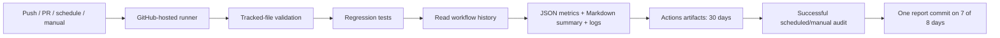

# Daily Log — Repository Reliability Lab

An automated repository maintenance pipeline built with Python and GitHub Actions.
It validates real files, runs regression tests, and archives verified audit reports
on seven of every eight calendar days (87.5%). These commits are automated telemetry,
not evidence of human development activity.

[](https://github.com/Jhenrique00/daily-log/actions/workflows/daily-log.yml)

## What this project demonstrates

- **CI and scheduled operations:** the same audit runs on pushes, pull requests,
  manual dispatch and twice-daily cloud schedules.
- **Data integrity:** tracked-file inventory with SHA-256 hashes, byte counts,
  JSON parsing, Python syntax checks and local Markdown file-link validation.
- **Observability:** machine-readable metrics, readable summaries, test output,
  and diagnostic logs retained even when a check fails.
- **Resilience:** bounded API retries, pagination, explicit failure on incomplete
  history, timeouts and serialized execution per branch.
- **Least privilege:** read-only audit jobs and a separate publisher with write
  permission only for scheduled/manual runs on main; temporary GitHub token and
  immutable action references.

This is a small engineering lab, not a production service or evidence of daily
manual coding. Its value is in the implementation and reproducible tests.

## Architecture



The audit lives in [scripts/audit.py](scripts/audit.py), its regression suite in
[tests/test_audit.py](tests/test_audit.py), and orchestration in
[daily-log.yml](.github/workflows/daily-log.yml). Python uses only the standard library.
PR audits run offline and explicitly mark historical metrics as skipped.

## Reliability measurements

Coverage = distinct days with at least one successful scheduled/manual run on
`main` / eligible calendar days. Windows cover the preceding 7 and 30 days in
`America/Bahia`, starting on the date in [automation.json](automation.json).
The current day is excluded because it is still in progress. Duplicate runs count
once. Push/PR checks do not count. Missing days remain missing; zero eligible days
produce `null`/N/A, not 100%. Runs are assigned to their creation date in Bahia.

**85% remains an indicative audit reliability target**, separate from the 87.5%
report-publication schedule below. API errors make metrics unavailable and fail the
audit instead of publishing a fabricated healthy result.

## Automated report commits and profile activity

Starting on 2026-10-25, publication follows a deterministic eight-day cycle:
seven eligible days, then one rest day. With successful execution, every full cycle
has 87.5% publication coverage; any 30-day window has 26 or 27 eligible days
(86.7% or 90%). This is a schedule, not a guarantee of the profile's green-square rate.
Existing activity, contributions in other repositories, failures and GitHub's counting
rules affect the actual profile. No dates are backfilled and no empty commits are made.

On eligible days, the first successful scheduled/manual audit archives its measured
inventory, hashes, test outcome and run metrics in `data/latest-audit.json`. The second
run still performs checks but does not create another report commit that day.
Git history retains earlier reports. Push and PR audits never publish report commits.
Stale, failed, offline or unrelated run reports are rejected. A concurrent change to
main causes publication to fail safely; the next scheduled run can try again.

Commit messages use `chore(automation)` and explicitly identify machine-generated
telemetry. The account's GitHub noreply address associates report authorship with
`Jhenrique00`; the committer is `github-actions[bot]`. This attribution is intentional
for profile contribution counting and does not mean the owner wrote code that day.
The project remains public so its activity can be inspected without private-profile
settings. GitHub may take up to 24 hours to display qualifying contributions.

The publication rule is implemented in [publish_report.py](scripts/publish_report.py)
and verified by [publication tests](tests/test_publish_report.py).

`metrics.json` includes 7/30-day coverage, missing dates, workflow conclusions,
file hashes, sizes, tested commit and run ID. `summary.md`, `tests.log` and
`audit.log` explain the result. The running execution is not claimed as a completed
success. A failed run remains visible in GitHub Actions even if a later run succeeds.

## Run and inspect

Requires Python 3.10+ and Git. Linux runners include the timezone database;
on Windows, install `tzdata` if `ZoneInfo` cannot locate `America/Bahia`.

```bash
python -m unittest discover -s tests -v
python scripts/audit.py --offline
```

For online metrics, set `GH_TOKEN` to a token with Actions read access to this
repository and run `python scripts/audit.py`. Never commit tokens. The workflow
uses the temporary built-in token; no personal token or computer left on is needed.

Open **Actions → Repository maintenance → a run** for the job summary and downloadable
`maintenance-<run-id>-<attempt>` artifact. Trigger an audit with **Run workflow**.
Schedules request execution at **06:17 and 20:17 in Bahia**. Both perform actual
checks, also providing another opportunity after a transient failure.

## Failure handling and limits

- Invalid files, broken local file links, failing tests or unavailable API metrics
  result in a nonzero exit. Reports are uploaded with `always()` when available.
- Transient network errors and HTTP 429/5xx are retried up to three total attempts;
  authentication failures stop immediately. Requests have a 30-second timeout.
- Tests have a 120-second timeout; the job is bounded to 10 minutes. Filtered API
  results reaching 1,000 runs are rejected rather than reported partially.
- GitHub schedules can be delayed or dropped; Actions outages, account minute
  allowances, disabled workflows and deleted history affect observations.
- Configure GitHub's Actions notifications to receive failure alerts. This project
  does not send emails or open issues. A run that never starts cannot alert by itself.
- In a public repository, GitHub disables schedules after 60 days without repository
  activity. Re-enable the workflow in Actions if that happens; do not manufacture
  commits to keep it alive. See [GitHub's workflow lifecycle documentation](https://docs.github.com/en/actions/how-tos/manage-workflow-runs/disable-and-enable-workflows).
- Artifact retention is 30 days, not permanent archival. External URLs and Markdown
  anchor existence are intentionally outside the local file-link check's scope.
- No dependency vulnerability scan is claimed: the application has no third-party
  Python runtime dependencies. Review pinned action updates deliberately.

## Historical transparency

The original workflow updated a date-only record daily using the account's author
identity. It was replaced by audits and artifacts, then extended to archive actual
successful audit reports on the documented 7-of-8-day cycle. The existing
[daily-log.json](daily-log.json) remains as an unchanged legacy record; prior commits
are preserved. Neither those records nor automated runs represent human coding days.

## Design tradeoffs

Artifacts retain detailed diagnostic logs for 30 days. Committing the latest report
also preserves measured results in Git history, at the cost of regular automated
commits and repository growth. Standard-library Python reduces installation overhead,
while explicit API pagination and tests keep the reliability calculation inspectable.
An external missed-run monitor remains a possible future improvement.

References: [GitHub scheduled events](https://docs.github.com/en/actions/reference/workflows-and-actions/events-that-trigger-workflows#schedule)
and [workflow run API](https://docs.github.com/en/rest/actions/workflow-runs).
Contribution criteria: [GitHub profile contributions reference](https://docs.github.com/en/account-and-profile/reference/profile-contributions-reference).
